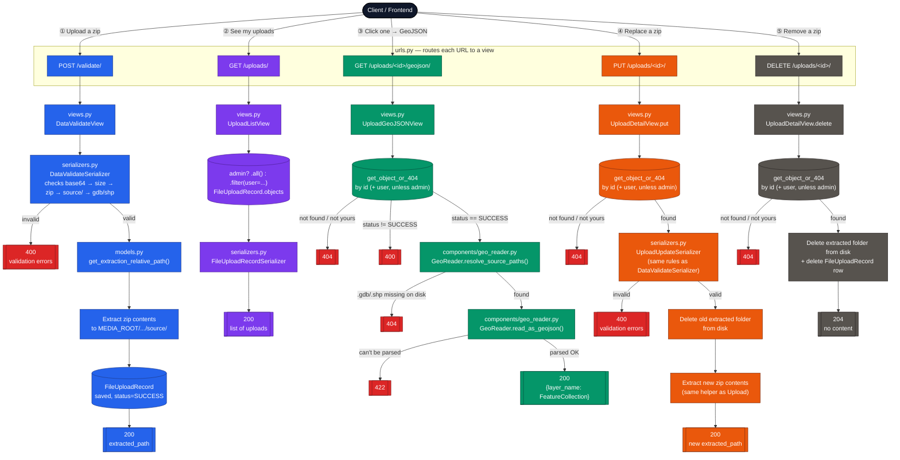
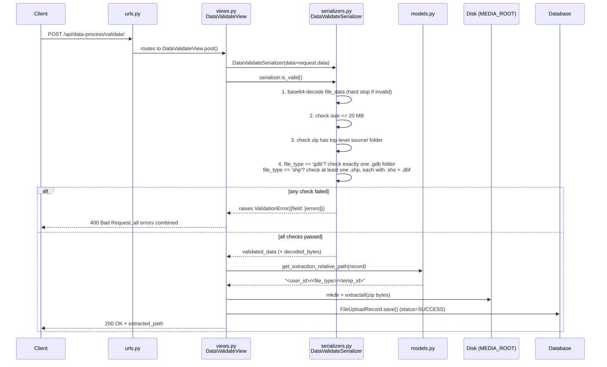
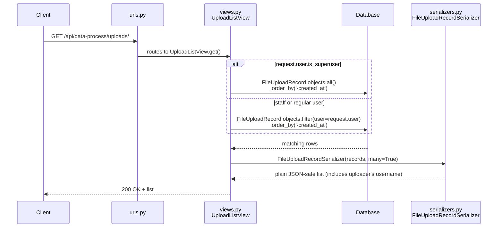
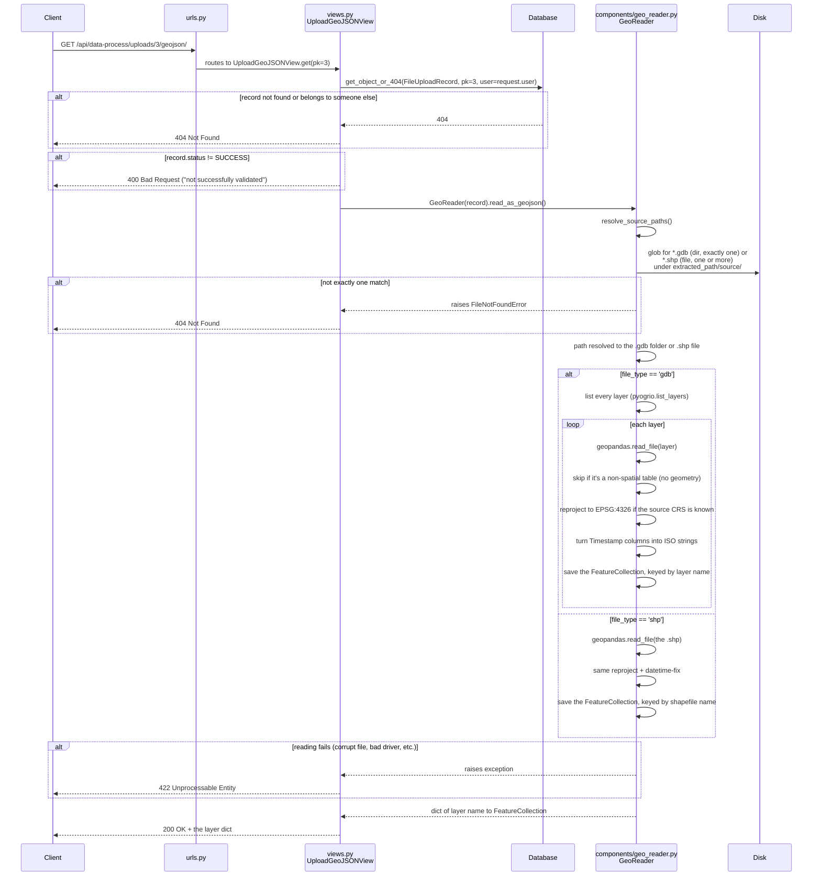
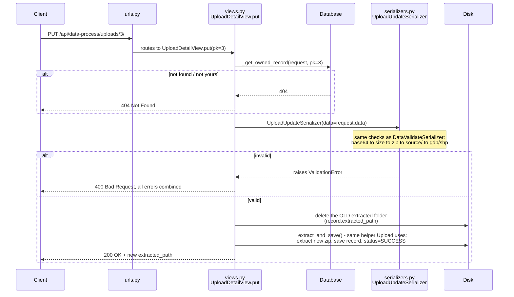
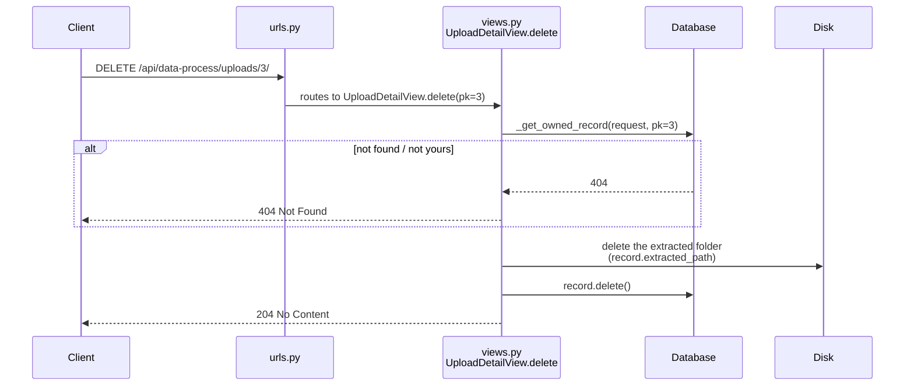
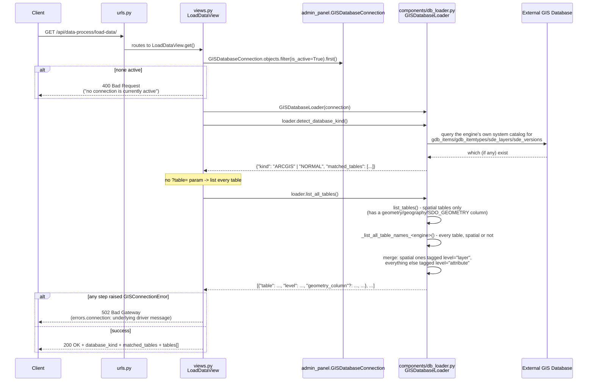
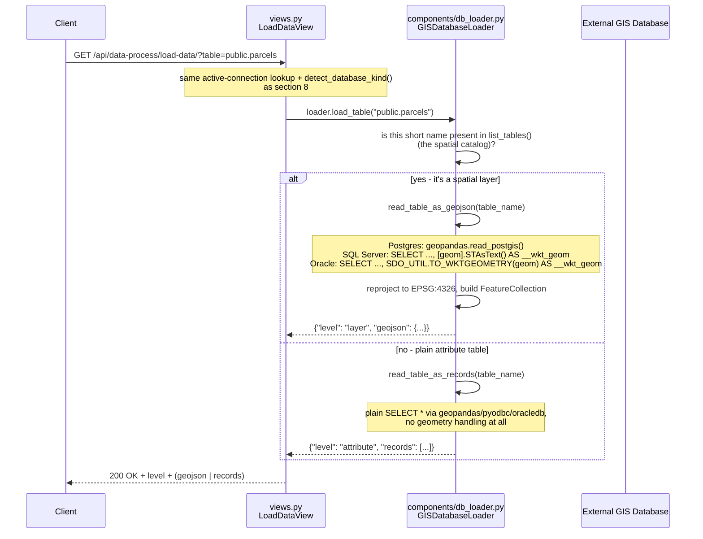
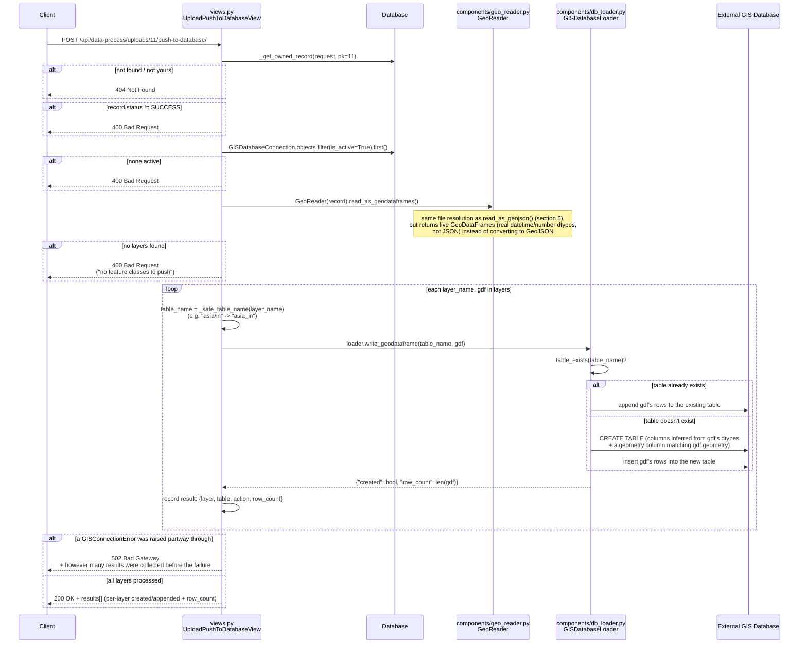

# Data Process Flow — Upload, List, GeoJSON, Live Database & Push-to-Database

This document explains **what actually happens, step by step, inside the code** when someone calls one of the eight `data_process` APIs. It is written for a developer who has never seen this app before and needs to trace a bug or add a feature without guessing.

The first five APIs (sections 3–7) work entirely with **uploaded files** (`.gdb`/`.shp` zips). The last three (sections 8–10) work with a **live external GIS database** instead — reading its tables directly, and pushing an upload's data into it — via `admin_panel.models.GISDatabaseConnection` and `components/db_loader.py`.

All diagrams use [Mermaid](https://mermaid.js.org/) — they render automatically on GitHub and in most modern code editors (VS Code, JetBrains, etc.) when viewing this `.md` file.

---

## 1. The big picture

There are five APIs, covering the full lifecycle: **upload → list → view → update → delete**. The diagram below shows every file each request passes through, and where it can branch off into an error response. Blue = upload, purple = list, green = GeoJSON, orange = update, gray = delete, red = an error exit.



**How to read it:** follow one color at a time, top to bottom. Every box is a real file/function you can open — e.g. if a GeoJSON request is failing with a `422`, the diagram tells you the bug is in `components/geo_reader.py`, not in the view or the database lookup.

1. **Upload** — user sends a zip (as base64 text) containing a `.gdb` or `.shp` dataset. The backend checks it's well-formed, then unzips it onto disk and records the upload in the database.
2. **List** — user asks "what have I uploaded?" and gets back the history.
3. **GeoJSON** — user picks one upload and the backend reads the actual spatial file on disk and converts it to GeoJSON so it can be drawn on a map.
4. **Update** — user replaces an existing upload's zip with a new one. The old extracted files are deleted first, then the new zip is validated and extracted in their place, exactly like a fresh upload.
5. **Delete** — user removes an upload entirely: its extracted files are deleted from disk and its database row is removed.

---

## 2. Where the code lives

| File | Purpose (one line) |
|---|---|
| `backend/data_process/urls.py` | Maps a URL to the view that handles it. The front door. |
| `backend/data_process/views.py` | The "traffic controller" — receives the HTTP request, calls the right helpers, decides the HTTP response. Deliberately kept thin. |
| `backend/data_process/serializers.py` | All **input validation** logic lives here. Views never validate anything themselves. |
| `backend/data_process/models.py` | The database table (`FileUploadRecord`) + `get_extraction_relative_path()`, the helper that computes where an upload's zip gets extracted to. |
| `backend/data_process/components/geo_reader.py` | The `GeoReader` class — everything about reading a validated upload's spatial data lives here: finding the `.gdb`/`.shp`(s) on disk (`resolve_source_paths()`), converting them to GeoJSON (`read_as_geojson()`) or to raw GeoDataFrames for a database write (`read_as_geodataframes()`), using `geopandas`/`pyogrio`. |
| `backend/data_process/components/db_loader.py` | The `GISDatabaseLoader` class — the live-database counterpart to `GeoReader`. Connects to whichever `GISDatabaseConnection` is `is_active` (PostgreSQL/PostGIS, SQL Server, or Oracle), lists/reads its tables, and writes an uploaded feature class into it. |
| `backend/admin_panel/models.py` | `GISDatabaseConnection` — the saved connection config (host, credentials, `is_active` flag) that `db_loader.py` connects with. Not owned by `data_process`, but everything in sections 8–10 reads it. |

This is a deliberate layering: **serializers validate, models describe upload data + storage paths, views orchestrate, `GeoReader` owns everything about locating and reading uploaded GIS data, `GISDatabaseLoader` owns everything about talking to a live external GIS database.** If you're fixing a validation bug, go to `serializers.py`. If you're fixing "wrong features returned" or "can't find the .gdb/.shp" from an **upload**, go to `components/geo_reader.py`. If you're fixing anything about the **live database** (wrong tables listed, a write went to the wrong table, a connection error), go to `components/db_loader.py`. If you're fixing "wrong HTTP status/response shape", go to `views.py`.

Two things live in `views.py` itself rather than a dedicated file, since they're small and only used by views: `_get_owned_record(request, pk)` (the admin-or-owner lookup shared by the GeoJSON, update, and delete endpoints) and `_extract_and_save(record, ...)` (the zip-extraction + DB-save steps shared by upload and update). `DataValidateSerializer` and `UploadUpdateSerializer` similarly share their zip-structure validation via a `ZipPayloadValidationMixin` in `serializers.py`, so the create and update rules can never quietly drift apart.

Every response (success or failure) uses the same envelope, so the frontend never has to guess the shape:

```json
{
  "success": true | false,
  "message": "human readable summary",
  "data": { ... } | null,
  "errors": { "field_name": ["error 1", "error 2"] } | null
}
```

---

## 3. API #1 — Upload & Validate: `POST /api/data-process/validate/`

**Purpose:** take a base64-encoded zip, make sure it's structurally correct, extract it to disk, and remember it in the database.

### What the caller sends

```json
{
  "user_id": "101",
  "temp_id": "sess_8892",
  "file_type": "gdb",       // or "shp"
  "file_data": "<base64 zip>"
}
```

### Step-by-step trace



### Where things live afterwards

```
MEDIA_ROOT/<authenticated_user_id>/<file_type>/<temp_id>/source/...
```

Example: `backend/media/5/gdb/sess_8892/source/GIS-DB-F.gdb/`

Note the **`<authenticated_user_id>` comes from the JWT token** (`request.user`), not the `user_id` field in the request body — that field is only echoed back, it isn't trusted for anything.

### Validation rules (in `serializers.py`)

| Check | Applies to | Rule |
|---|---|---|
| Base64 decode | always | Must decode cleanly. **Hard stop** — if this fails, nothing else is checked. |
| Size | always | Decoded bytes must be ≤ 20 MB. |
| Zip validity | always | Must be openable as a real zip. |
| `source/` folder | always | Zip must contain a top-level `source/` directory. |
| `.gdb` folder | `file_type: "gdb"` | Exactly one `<name>.gdb` folder directly inside `source/`. |
| `.shp` file | `file_type: "shp"` | At least one `<name>.shp` anywhere inside `source/` — **including subfolders**, and multiple are allowed (e.g. one per country/region, each in its own subfolder). **Each** one found must have its own `.shx` and `.dbf` siblings present alongside it. |

All of these (except the base64 hard-stop) are collected together — if 3 things are wrong, you get all 3 error messages in one response, not one-at-a-time.

### What gets saved to the database

A `FileUploadRecord` row (see `models.py`):

| Field | Meaning |
|---|---|
| `user` | who uploaded it (from the JWT, not the request body) |
| `temp_id` | the caller-supplied session/transaction id |
| `file_type` | `'gdb'` or `'shp'` |
| `extracted_path` | where on disk it landed, **relative to `MEDIA_ROOT`** |
| `status` | `PENDING` / `VALIDATING` / `SUCCESS` / `FAILED` (see note below) |
| `status_message` | success text, or (in principle) error text |

> **Developer note:** today, a *validation failure never creates a database row* — the view returns the 400 response directly and nothing is saved. The `FAILED` status exists in the model's choices but no code path currently sets it. If you're debugging "why don't failed uploads show up in the list", this is why — by design, only successful extractions are recorded.

---

## 4. API #2 — List Uploads: `GET /api/data-process/uploads/`

**Purpose:** show the logged-in user their upload history, most recent first. What you see depends on your role: **admins (superusers) see everyone's uploads; everyone else (staff or regular users) only see their own.**



This is intentionally the simplest of the three — no disk access, just a database query. The only branch is **who** the query is scoped to: `request.user.is_superuser` decides between "every upload" and "just mine." This is why the serializer includes a `username` field — without it, an admin looking at everyone's uploads couldn't tell whose is whose.

### Response shape

```json
{
  "success": true,
  "message": "2 upload(s) found.",
  "data": [
    {
      "id": 3,
      "username": "john_doe",
      "temp_id": "sess_8892",
      "file_type": "gdb",
      "status": "SUCCESS",
      "status_message": "File validation passed successfully.",
      "created_at": "2026-08-02T02:55:37.003Z",
      "updated_at": "2026-08-02T02:55:37.003Z"
    }
  ],
  "errors": null
}
```

`id` here is what you pass to API #3 to get that upload's GeoJSON.

---

## 5. API #3 — Get GeoJSON: `GET /api/data-process/uploads/<id>/geojson/`

**Purpose:** the "click on a zip" feature — take a previously-uploaded `.gdb` or `.shp`, read every spatial feature inside it, and return one GeoJSON `FeatureCollection` per feature class/layer, keyed by layer name, ready to draw on a map.



### Why some steps exist (the "why", not just the "what")

- **Reprojection to EPSG:4326 (WGS84):** GeoJSON (RFC 7946) requires coordinates in WGS84 lat/lon. A `.gdb`/`.shp` can be stored in any coordinate system (e.g. a local UTM zone), so a layer is reprojected before being converted **if its source CRS is known**, otherwise the coordinates would be meaningless on a standard web map. If a layer has no CRS defined at all (common for some enterprise datasets), its coordinates are returned exactly as stored — there is nothing to convert *from*.
- **Datetime → string conversion:** `geopandas`'s `to_json()` cannot serialize pandas `Timestamp` objects — a real bug hit and fixed during development. Date/datetime fields (very common in `.gdb` attribute tables) are converted to ISO 8601 strings first.
- **Skipping non-spatial tables:** a `.gdb` can contain plain attribute tables with no geometry at all (lookup tables, etc.). These can't become GeoJSON features, so they're silently skipped — only true feature classes/layers make it into the output.
- **Keyed by layer name, not merged:** a `.gdb` can have many feature classes (parcels, roads, boundaries, ...), each with its own schema and geometry type. Rather than merging everything into one `FeatureCollection`, each layer gets its own entry in the response dict — the frontend can enable/disable or style each layer independently without having to filter a merged list first.

### Response shape

The response is a dict keyed by feature class/layer name (for `.shp` uploads, one key per shapefile found anywhere inside `source/` — e.g. `ar`, `bo`, `cl`, ... if the upload contained one shapefile per country. If a shapefile is nested in a subfolder, its key includes the sub-path, e.g. `asia/in`, so two same-named shapefiles in different subfolders never overwrite each other). Each value is a standalone GeoJSON `FeatureCollection`:

```json
{
  "success": true,
  "message": "2 layer(s), 18 feature(s) extracted.",
  "data": {
    "PARCEL": {
      "type": "FeatureCollection",
      "features": [
        {
          "type": "Feature",
          "properties": { "PARCEL_ID": 12, "...": "..." },
          "geometry": { "type": "Polygon", "coordinates": [ ["..."] ] }
        }
      ]
    },
    "TRANSPORT_NETWORK": {
      "type": "FeatureCollection",
      "features": [
        {
          "type": "Feature",
          "properties": { "SectionId": "SBF3969_11 KV MAGADH MEDICAL2901", "...": "..." },
          "geometry": { "type": "LineString", "coordinates": [ ["..."] ] }
        }
      ]
    }
  },
  "errors": null
}
```

### Error cases at a glance

| Situation | HTTP status | Why |
|---|---|---|
| `id` doesn't exist, or belongs to another user (and you're not an admin) | `404` | `get_object_or_404` is filtered by `user=request.user` for non-admins, so it can't tell the difference between "doesn't exist" and "not yours" — which is intentional, it avoids leaking that another user's upload ID exists. Superusers skip this filter entirely and can fetch any user's upload by id. |
| Upload exists but `status != SUCCESS` | `400` | Nothing was ever extracted to disk, so there's nothing to read. |
| Extracted folder is missing, or doesn't contain the required `.gdb` (exactly one) / `.shp` (at least one) | `404` | The database says it should be there, but the disk disagrees (e.g. manually deleted, or corrupted extraction). |
| The `.gdb`/`.shp` exists but can't be read (corrupt, unsupported driver, etc.) | `422` | The file exists but `geopandas`/`pyogrio` couldn't parse it. |

---

## 6. API #4 — Update Upload: `PUT /api/data-process/uploads/<id>/`

**Purpose:** replace an existing upload's contents with a new zip — same validation rules as a brand-new upload, but reusing the same `FileUploadRecord` row and (by default) the same storage path.



**Why delete-then-extract, not extract-over-the-top:** if the old upload had files the new one doesn't (e.g. old had `ar.shp` + `bo.shp`, new only has `ar.shp`), simply extracting on top would leave `bo.shp` behind as stale leftover data that would silently show up in every future GeoJSON read. Deleting the whole folder first guarantees the extracted contents always match exactly what's in the newest zip.

### Request Body
Only the new file itself is required — `temp_id` isn't accepted here since it isn't changing, and the record being updated is already identified by the URL's `<id>`.
```json
{
  "file_type": "shp",
  "file_data": "UEsDBBQAAAAIAI9iW..." // Base64 encoded ZIP stream
}
```

### Error cases at a glance

| Situation | HTTP status | Why |
|---|---|---|
| `id` doesn't exist, or belongs to another user (and you're not an admin) | `404` | Same admin-or-owner rule as the GeoJSON and delete endpoints. |
| Zip payload fails validation (bad base64, oversized, wrong structure, etc.) | `400` | Identical rules to a brand-new upload — see section 3, API #1, above. |

---

## 7. API #5 — Delete Upload: `DELETE /api/data-process/uploads/<id>/`

**Purpose:** remove an upload entirely — both its database record and its extracted files on disk.



There's no request body and no response body — a successful delete is just `204 No Content`. Like the other endpoints, `_get_owned_record` means admins can delete any user's upload while everyone else can only delete their own.

---

## 8. API #6 — Load Live Data: `GET /api/data-process/load-data/`

**Purpose:** everything so far reads *uploaded files*. This endpoint instead reads directly from a **live external database** — whichever `admin_panel.models.GISDatabaseConnection` row currently has `is_active=True`. With no `?table=` parameter, it lists every table on that database. See section 9 for loading one table's actual data.

### Step-by-step trace



### `detect_database_kind()` — why it runs first, every time

Before listing or reading anything, `LoadDataView` always calls `loader.detect_database_kind()` first (see `GISDatabaseLoader.detect_database_kind` in `db_loader.py`). It checks whether any of four Esri system-table names exist on the connected database, case-insensitively:

| Marker table | What it means |
|---|---|
| `gdb_items`, `gdb_itemtypes` | Modern (10.1+) Esri File/Enterprise Geodatabase catalog tables |
| `sde_layers`, `sde_versions` | Classic ArcSDE catalog tables |

If any are found, `database_kind` is `"ARCGIS"`; otherwise `"NORMAL"`. **This is informational only today** — the result is included in every `load-data` response (`data.database_kind`, `data.matched_tables`), but nothing downstream currently branches on it. It exists so a future change (e.g. reading ArcGIS's versioned/branch layers differently from a plain table) has a place to hook in without re-deriving "is this ArcGIS?" from scratch.

### `list_all_tables()` — how "layer" vs. "attribute" is decided

1. `list_tables()` queries each engine's **spatial metadata catalog** — `geometry_columns` (Postgres), `sys.columns` joined against `sys.types` filtered to `geometry`/`geography` (SQL Server), or `user_sdo_geom_metadata` (Oracle) — returning only tables that have a geometry column.
2. A second, engine-specific query lists **every** table regardless of geometry: `information_schema.tables` (Postgres, excluding `pg_catalog`/`information_schema`), `sys.tables` joined to `sys.schemas` (SQL Server), or `user_tables` (Oracle).
3. The two lists are merged by short table name (case-insensitive, schema prefix and any `"`/`[]` quoting stripped): anything present in the spatial list gets `"level": "layer"` plus its `geometry_column`/`srid`/`geometry_type`; everything else gets `"level": "attribute"`.

The frontend uses this `level` to decide how to render each table: a `"layer"` gets loaded onto the map, an `"attribute"` table gets loaded into the simple floating table.

### Response shape

```json
{
  "success": true,
  "message": "12 table(s) found on 'db.internal:5432/gis_prod'.",
  "data": {
    "connection": { "id": 1, "gisdbtype": "POSTGRES", "instance": "db.internal:5432", "database": "gis_prod" },
    "database_kind": "NORMAL",
    "matched_tables": [],
    "tables": [
      { "table": "public.parcels", "level": "layer", "geometry_column": "geom", "srid": 4326, "geometry_type": "MULTIPOLYGON" },
      { "table": "public.zoning_lookup", "level": "attribute" }
    ]
  },
  "errors": null
}
```

### Error cases at a glance

| Situation | HTTP status | Where it's raised |
|---|---|---|
| No `GISDatabaseConnection` has `is_active=True` | `400` | `LoadDataView.get`, before touching `GISDatabaseLoader` at all |
| Connection refused, DNS failure, bad credentials, table doesn't exist, etc. | `502` | Any per-engine helper in `db_loader.py` catches the driver's own exception and re-raises `GISConnectionError` with a descriptive message; the view catches that one exception type and turns it into a `502` |

---

## 9. API #7 — Load Live Data, One Table: `GET /api/data-process/load-data/?table=<name>`

**Purpose:** same URL as section 8, with a `table` query parameter — reads that table's actual rows instead of just listing it, auto-detecting whether it's a spatial layer or a plain attribute table.



### Why SQL Server and Oracle convert geometry to WKT in the query itself

Postgres has a first-class Python binding for its geometry type (`geopandas.read_postgis` understands PostGIS's binary format directly). SQL Server and Oracle don't have an equivalent lightweight Python-side decoder available here, so instead the **SQL query itself** does the conversion — `.STAsText()` (SQL Server) and `SDO_UTIL.TO_WKTGEOMETRY()` (Oracle) both convert the native geometry value to a WKT (Well-Known Text) string *inside the database*, which any `shapely`/`geopandas` version can parse identically regardless of source engine. This is why `_rows_to_feature_collection()` in `db_loader.py` looks the same for both engines — by the time it runs, the engine-specific part is already done.

### Response shape (either variant)

See section 22 in `Api_document.md` for full JSON examples of both the `"layer"` and `"attribute"` shapes.

### Error cases at a glance

Same as section 8 (`400` if no connection is active, `502` for any connection/query failure) — `load_table()` doesn't introduce any new failure mode of its own, it just dispatches to whichever read path applies.

---

## 10. API #8 — Push Upload to Database: `POST /api/data-process/uploads/<id>/push-to-database/`

**Purpose:** the reverse direction of sections 8–9 — instead of *reading* the live database, this *writes* into it, using an already-validated upload as the source. For every feature class in the upload, it checks whether a same-named table already exists on the active connection: if so, the upload's rows are **appended**; if not, the table is **created first** (with a matching geometry column), then the rows are inserted.



### `read_as_geodataframes()` vs. `read_as_geojson()` — why a separate method

`GeoReader.read_as_geojson()` (used by section 5's endpoint) deliberately stringifies datetime columns and JSON-encodes everything, because GeoJSON is a JSON format. A database write needs the **opposite**: real `datetime`/`int`/`float` Python values, so the new table's columns can be created with proper types (`DATETIME2` instead of `NVARCHAR`, etc.) and so the target database stores genuine typed values, not date-strings. `read_as_geodataframes()` shares the exact same file-resolution and layer-reading code as `read_as_geojson()` (both now route through the same private `_read_gdb_as_geodataframes`/`_read_shp_as_geodataframes` helpers) but stops one step earlier — it reprojects to WGS84 and returns the live `GeoDataFrame`, without the datetime-to-string or JSON conversion step. `read_as_geojson()` is now implemented as a thin wrapper: read the GeoDataFrames, then convert each one with `_feature_collection()`.

### How each engine actually writes

| Engine | Method | How create-vs-append is decided | How the write happens |
|---|---|---|---|
| PostgreSQL | `_write_geodataframe_postgres` | Not decided explicitly — `geopandas.GeoDataFrame.to_postgis(if_exists="append")` creates the table automatically the first time (via GeoAlchemy2, with a proper PostGIS geometry column + SRID) and appends on every later call. `already_existed` (from `table_exists()`) is only used to report `"created"` vs `"appended"` back to the caller. |
| SQL Server | `_write_geodataframe_sqlserver` | `table_exists()` is checked explicitly first. If new: `CREATE TABLE` with one column per `GeoDataFrame` column — `geometry` type for the geometry column, else a type picked from the pandas dtype (`BIT`/`BIGINT`/`FLOAT`/`DATETIME2`/`NVARCHAR(MAX)`, see `_sqlserver_column_type`). Then `cursor.executemany()` inserts every row, with the geometry column bound as `geometry::STGeomFromText(?, 4326)`. |
| Oracle | `_write_geodataframe_oracle` | Same pattern as SQL Server: `CREATE TABLE` (if new) with an `SDO_GEOMETRY` column plus dtype-mapped columns (`NUMBER(1)`/`NUMBER(19)`/`BINARY_DOUBLE`/`TIMESTAMP`/`NCLOB`, see `_oracle_column_type`), then `cursor.executemany()` inserting each row with the geometry column bound as `SDO_UTIL.FROM_WKTGEOMETRY(:n)`. |

`_sql_safe_value()` is a small shared helper that runs on every non-geometry value before it's bound as a query parameter — it unwraps numpy scalars (`int64`, `float64`, `bool_`, ...) to plain Python values, turns `NaN`/`NaT`/`None` into `None`, and converts a pandas `Timestamp` to a plain `datetime`. Without it, `pyodbc`/`oracledb` would either reject numpy-typed values outright or silently mis-bind them.

### Known limitations (disclosed, not hidden)

- **Only the PostgreSQL write path has been exercised against a real database** (via `to_postgis`, a well-trodden geopandas feature). The SQL Server and Oracle write paths are implemented against each vendor's documented SQL (confirmed to run without crashing against a live-but-unreachable test connection, returning a clean `502` rather than a stack trace) but have not been verified against a real reachable instance of either engine.
- **The Oracle write path does not register the new geometry column in `USER_SDO_GEOM_METADATA` or build a spatial index.** Oracle Spatial requires that bookkeeping (which itself requires knowing the layer's real coordinate extent) before a `SDO_GEOMETRY` column can be used in spatial queries or indexed — the column is written and readable via plain SQL, but a newly *created* table's geometry column won't be spatially query-able until that's done as a separate step.
- **Only spatial feature classes are pushed.** A `.gdb`'s plain, non-spatial tables are skipped by `GeoReader` entirely (same as the GeoJSON endpoint, section 5) — there's currently no code path that reads or pushes those.
- **Not transactional across layers.** If layer 3 of 5 fails, layers 1–2 are already committed to the external database and stay that way — `results` in the error response tells the caller exactly how far it got, so a retry (after fixing the underlying issue) can be reasoned about, but the caller can't "undo" the partial push automatically.

### Response shape

```json
{
  "success": true,
  "message": "Pushed 2 feature class(es) to 'db.internal:5432/gis_prod' (1 created, 1 appended).",
  "data": {
    "connection": { "id": 1, "instance": "db.internal:5432", "database": "gis_prod" },
    "results": [
      { "layer": "PARCEL", "table": "PARCEL", "action": "appended", "row_count": 240 },
      { "layer": "asia/in", "table": "asia_in", "action": "created", "row_count": 18 }
    ]
  },
  "errors": null
}
```

### Error cases at a glance

| Situation | HTTP status | Why |
|---|---|---|
| `id` doesn't exist, or belongs to another user (and you're not an admin) | `404` | Same `_get_owned_record` rule as sections 5–7. |
| Upload exists but `status != SUCCESS` | `400` | Nothing was ever extracted, so there's nothing to read/push. |
| No `GISDatabaseConnection` has `is_active=True` | `400` | Nowhere to push to. |
| Upload has no spatial feature classes (e.g. only plain tables) | `400` | Nothing for `write_geodataframe()` to do. |
| A write fails partway through (bad credentials, connection drop, disallowed column type, etc.) | `502` | Wraps whichever `GISConnectionError` the failing per-engine write method raised; `data.results` shows progress up to the failure. |

---

## 11. Quick reference table

| # | Endpoint | Method | Entry point | Touches DB? | Touches disk? |
|---|---|---|---|---|---|
| 1 | `/api/data-process/validate/` | `POST` | `views.DataValidateView.post` | Writes 1 row (on success only) | Extracts zip to `MEDIA_ROOT` |
| 2 | `/api/data-process/uploads/` | `GET` | `views.UploadListView.get` | Reads rows (all rows if admin, else filtered by user) | No |
| 3 | `/api/data-process/uploads/<id>/geojson/` | `GET` | `views.UploadGeoJSONView.get` | Reads 1 row (any row if admin, else filtered by user) | Reads the extracted `.gdb`/`.shp` |
| 4 | `/api/data-process/uploads/<id>/` | `PUT` | `views.UploadDetailView.put` | Reads + updates 1 row (any row if admin, else filtered by user) | Deletes old extracted files, writes new ones |
| 5 | `/api/data-process/uploads/<id>/` | `DELETE` | `views.UploadDetailView.delete` | Deletes 1 row (any row if admin, else filtered by user) | Deletes the extracted files |
| 6 | `/api/data-process/load-data/` | `GET` | `views.LoadDataView.get` | Reads the active `GISDatabaseConnection` row only | No (queries the *external* live database, not `MEDIA_ROOT`) |
| 7 | `/api/data-process/load-data/?table=<name>` | `GET` | `views.LoadDataView.get` | Reads the active `GISDatabaseConnection` row only | No (queries the external live database) |
| 8 | `/api/data-process/uploads/<id>/push-to-database/` | `POST` | `views.UploadPushToDatabaseView.post` | Reads 1 upload row + the active `GISDatabaseConnection` row | Reads the extracted `.gdb`/`.shp`; **writes** to the external live database |

All eight require a valid JWT (`Authorization: Bearer <access_token>`) — see `documentation/Api_document.md` for auth endpoints. Endpoints 6–8 additionally require `IsStaffOrSuperuser` (they use stored external-database credentials), unlike 1–5 which only require `IsAuthenticated`.

---

## 12. Glossary (plain language)

- **`.gdb` (File Geodatabase):** a folder (not a single file!) that ESRI/ArcGIS uses to store one or more layers of spatial data together. One `.gdb` can contain many "feature classes" (layers) — e.g. `PARCEL`, `ROADS`, `BOUNDARY` all inside the same `.gdb`.
- **`.shp` (Shapefile):** an older, simpler format. Always comes as a *group* of files sharing the same name (`thing.shp`, `thing.shx`, `thing.dbf`, ...) — the `.shp` alone is useless without its `.shx`/`.dbf` siblings.
- **Layer / feature class:** one "table" of spatial data inside a `.gdb` — e.g. all the parcels, or all the roads.
- **Feature:** one row of spatial data — e.g. one parcel, with its shape (geometry) and its attributes (properties).
- **GeoJSON:** a JSON-based standard format for spatial data that web maps understand natively. A `FeatureCollection` is just "a list of Features" wrapped with a `type` label.
- **CRS / EPSG:4326:** the "coordinate system" a shape's numbers are measured in. `EPSG:4326` is WGS84 — plain latitude/longitude, the one every web map (Leaflet, Mapbox, Google Maps) expects.
- **base64:** a way to represent binary data (like a zip file) as plain text, so it can be sent inside a JSON request body.
- **`GISDatabaseConnection`:** a saved config (`admin_panel/models.py`) for one external GIS database — host, credentials, engine type. Exactly one can have `is_active=True` at a time (enforced by the model's own `save()`); every "live database" feature (sections 8–10) always reads/writes whichever one that is.
- **`GISDatabaseLoader`:** the class in `components/db_loader.py` that actually talks to the live external database — the live-database counterpart to `GeoReader` (which only ever reads *uploaded files*).
- **WKT (Well-Known Text):** a plain-text way to represent a geometry, e.g. `POLYGON((0 0, 1 0, 1 1, 0 0))`. Used as a lingua franca here: SQL Server's `.STAsText()` and Oracle's `SDO_UTIL.TO_WKTGEOMETRY()` both convert their engine-native geometry to WKT so the exact same Python code (`shapely.wkt.loads`) can turn it into a real geometry object regardless of source engine.
- **`SDO_GEOMETRY`:** Oracle Spatial's native geometry column type — Oracle's equivalent of PostGIS's `geometry` type or SQL Server's `geometry`/`geography` types.
- **ArcGIS marker tables:** `gdb_items`/`gdb_itemtypes` (modern Esri geodatabases) or `sde_layers`/`sde_versions` (classic ArcSDE) — system catalog tables whose mere presence identifies a database as an Esri geodatabase rather than a plain spatial database. See section 8.
